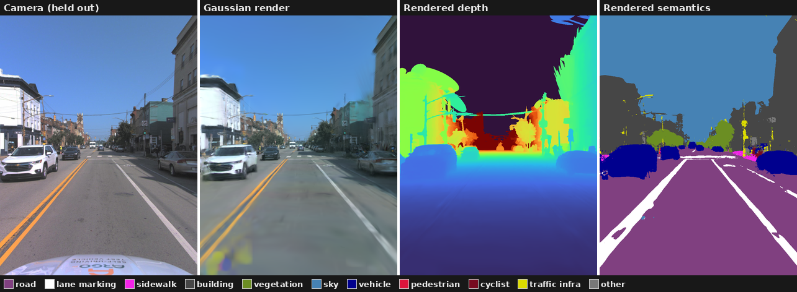
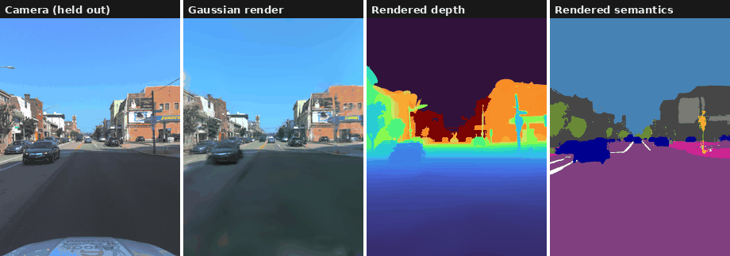
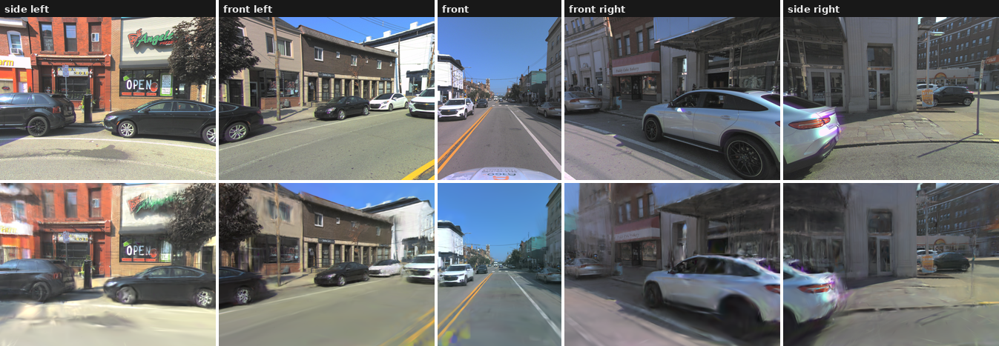
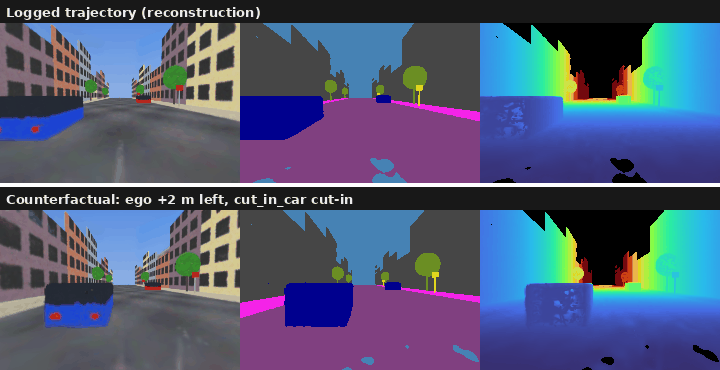

# Semantic 3DGS on Argoverse 2

**Goal:** Turn a recorded drive into a 3D scene that can re-render from new viewpoints, with colour, depth and semantic labels.

First, build a 3D Gaussian Splatting model of driving logs. Given camera images, LiDAR and 3D box tracks, learn a scene that can render from any viewpoint, including views the car never saw. Dataset used is [Argoverse 2](https://www.argoverse.org/av2.html).

### Key Pillars

| | |
|---|---|
| **LiDAR** | The 3D points come straight from the LiDAR scans. No COLMAP or structure-from-motion step is needed. |
| **Static background** | Roads, buildings and parked cars are one set of Gaussians that never moves. |
| **Moving cars** | Each moving vehicle gets its own small cloud of Gaussians that follows its 3D box track. A learnable correction fixes jittery boxes. |
| **Semantics** | Each Gaussian also learns a class (road, car, sky, …). The labels come from a 2D segmentation network and become consistent across views. |
| **Real-world fixes** | A sky backdrop, per-camera exposure correction and LiDAR depth supervision handle the messy parts of real data. |
| **"What if?" videos** | Once trained, you can move the ego car into another lane or make another car cut in, and render the result. |

### Flow:

1. LiDAR points are split into the static background vs. point cloud per moving object, using 3D boxes.
2. Each point becomes a Gaussian (position, size, rotation, opacity, colour, class scores).
3. For a given timestamp, every object's Gaussians are moved into the world by its box pose, then all Gaussians are rasterized together with [gsplat](https://github.com/nerfstudio-project/gsplat).
4. The renders are compared with the real images, LiDAR depth and 2D labels, and everything is optimized by gradient descent.

## Results

Every held-out frame along the Argoverse 2 log.

### All five cameras

Top row: real images. Bottom row: what the model renders for the same held-out moment.

### Argoverse 2

156 frames (about 15.6 s of footage, roughly 78 m of road), 5 cameras. Every 10th frame is held out for testing. That makes 80 test images, or 48 for the 3-camera run. Scores below are on the held-out images only.

| Run | Gaussians | PSNR ↑ | PSNR on cars ↑ | Depth error (AbsRel) ↓ | Semantic mIoU ↑ |
|---|---|---|---|---|---|
| Baseline (gsplat default noise) | 1.7 M | 20.06 | 18.91 | 0.035 | 0.647 |
| Baseline, `noise_lr=210` | 1.7 M | 20.51 | 19.35 | 0.028 | 0.656 |
| 6 M budget, `noise_lr=210` | 6.0 M | 20.51 | **19.51** | 0.029 | 0.664 |
| Front 3 cameras only | 1.7 M | **21.65** | **19.77** | **0.027** | **0.694** |

## Synthetic Scenes

We use `s3dgs synth` to render a procedural street where every camera, LiDAR point, box and label is exact for debugging purposes. This is especially interesting for rendering "counterfactual" scenes, a novel scene that never appeared in the log, to see how our reconstruction performs:

*Top: reconstruction of the logged drive. Bottom: shift the camera 2 m left while the tracked car cuts in.*

## Milestones

| | Goal | Stubs to implement | You're done when… |
|---|---|---|---|
| **M0** | Conventions | `geometry/conventions.py`, `invert_se3`, `transform_points`, `project_points` | `s3dgs check` overlays: LiDAR lands on edges, boxes on cars |
| **M1** | Static baseline | `box_to_pose`, `points_in_box`, `box_corners`, `classify_dynamic_tracks`, `accumulate_static_points`, `rgb_loss`, `opacity_regularization`, `scale_regularization` | `m1_static` trains; static PSNR is reasonable; moving cars are blurred/absent |
| **M2** | Scene graph | `quat_*`, `rotmat_to_quat`, `accumulate_object_points`, `compose_gaussians`, `object_frame_view_dirs` | `m2_dynamic`: cars are sharp; `psnr_dynamic` ≫ M1 |
| **M3** | Robustness | `so3_exp`, `se3_exp`, `se3_log`, `PoseRefinement`, `pixel_ray_directions`, `SkyCubemap.forward`, `ExposureCorrection`, `depth_loss`, `sky_loss` | `m3_full`: no sky floaters; no seam between cameras; depth AbsRel down |
| **M4** | Semantics | `semantic_loss` (+ run `s3dgs segment` on real data) | `m4_semantic`: mIoU vs 2D labels; semantics are view-consistent |
| **M5** | Counterfactual demo | `offset_pose` | `s3dgs render` produces the hero video |

## Stretch Goals (TODO)

- Rolling-shutter compensation (gsplat `RollingShutterType`; per-image shutter timing is already exported).
- Non-rigid pedestrians with a small deformation field per actor.
- Comparison to Street Gaussians / OmniRe on the same segments.
