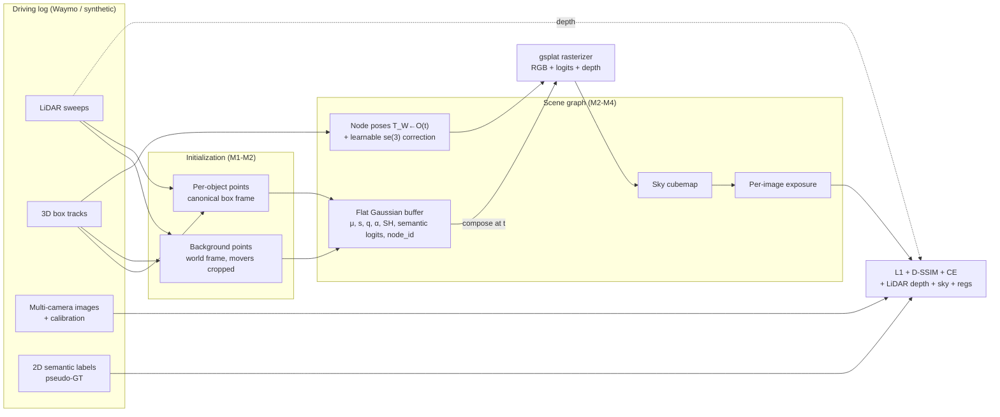
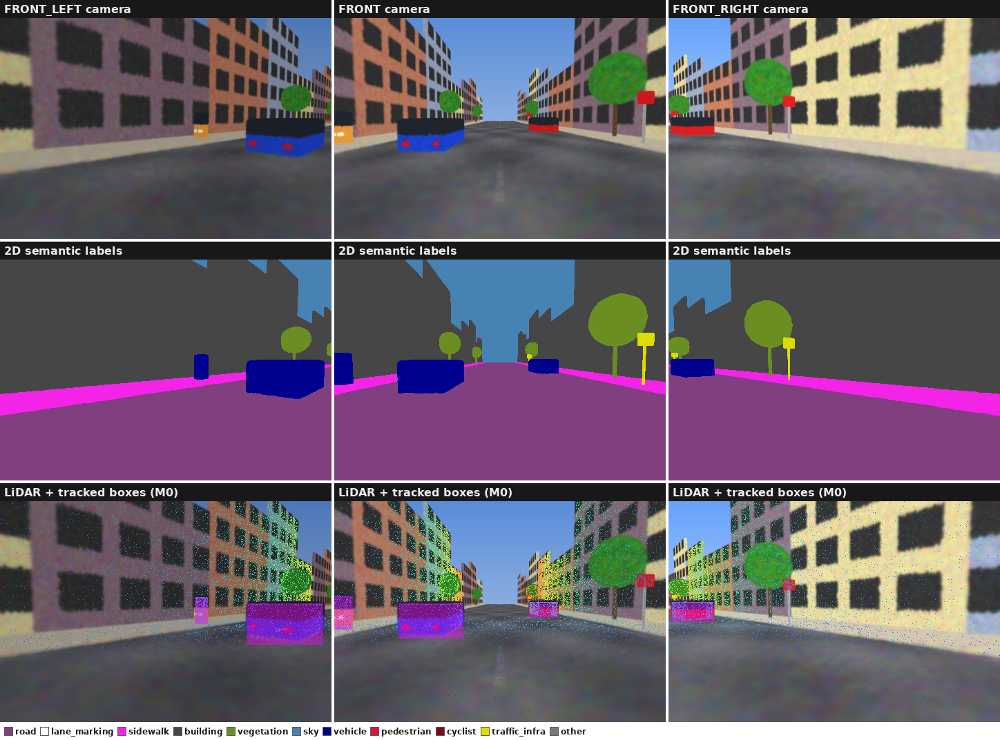
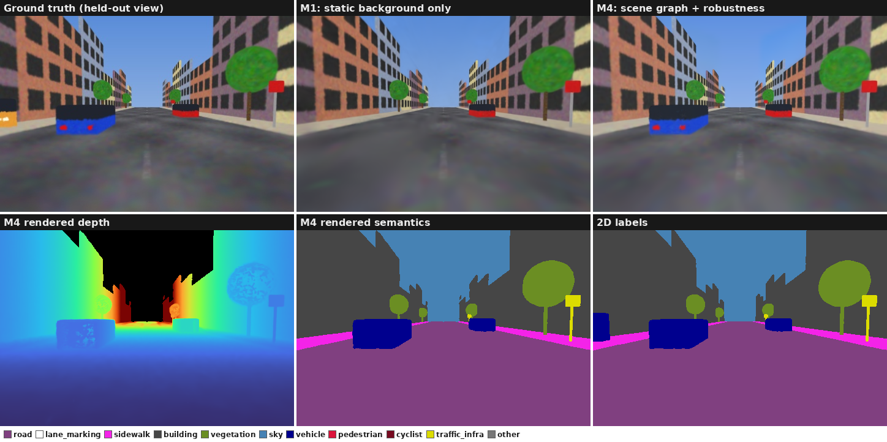

# semantic-3dgs

Scene-graph dynamic and semantic 3D Gaussian Splatting for driving logs, targeting the Waymo Open Dataset.

- **LiDAR initialization.** Gaussians are seeded from LiDAR, so no COLMAP step is needed.
- **Static background.** The background is a set of Gaussians fixed in the world frame.
- **Dynamic actors.** Each moving vehicle gets its own Gaussian cloud in its box frame, moved rigidly by the SE(3) box track. A learnable correction can refine each track pose.
- **Semantics.** Per-Gaussian class logits are distilled from 2D segmentation and alpha-blended with the same weights as RGB.
- **Robustness.** A sky cubemap, per-image exposure correction and LiDAR depth supervision are included.
- **Demo.** The final deliverable is a counterfactual video: the ego vehicle shifted one lane and an actor cut-in, rendered as RGB | semantics | depth.


*A reference implementation of every milestone on the bundled synthetic scene. Top: reconstruction of the logged drive. Bottom: the ego camera is shifted 2 m left while the tracked car cuts in. Panels are RGB | semantics | depth, all rendered from the same Gaussians.*

## How it works



> **This is a scaffold.** The infrastructure is complete: data loading, Waymo conversion, gsplat rasterization, densification, training loop, evaluation, visualisation and CLI. The *theory* is stubbed with `todo("Mx", hint)` and raises `NotImplementedError`. The tests in `tests/student/` are the specification. They fail until you implement each milestone.

## Setup

```bash
uv sync --extra cuda --extra dev --extra evaluation   # + --extra semantics for M4 pseudo-labels
uv run pytest tests/scaffold                          # infrastructure: should pass now
uv run pytest tests/student -m "not cuda"             # your work: unit specs, fail until implemented
uv run pytest tests/student/test_e2e_synthetic.py     # per-milestone training checks (CUDA, ~1 min each)
```

The first CUDA run JIT-compiles gsplat with the pip-installed `nvcc` (~2 min, cached afterwards; see `src/semantic_3dgs/_cuda.py`).

Waymo conversion needs TensorFlow, so it runs in a **separate** Python 3.10 environment:

```bash
uv venv .venv-waymo -p 3.10 && source .venv-waymo/bin/activate
uv pip install waymo-open-dataset-tf-2-12-0==1.6.4 opencv-python-headless tqdm
python scripts/preprocess_waymo.py SEGMENT.tfrecord data/scenes/waymo/SEGMENT_NAME
```

The on-disk scene format is documented at the top of `src/semantic_3dgs/data/scene.py`.

## The synthetic debug scene

`s3dgs synth` renders a procedural street with exact cameras, LiDAR, boxes and semantic labels. Use it to debug each milestone before moving to Waymo. It has a moving car that cuts in, a parked car (static, so it belongs to the background), a pedestrian (masked out of the loss), and per-camera exposure differences.



The bottom row is the M0 check (`s3dgs check`). Once your camera conventions are right, the LiDAR points land on edges and the box masks cover the actors.

## Milestones

Run one milestone at a time: `uv run pytest tests/student/test_m1_static.py -x`.

| | Goal | Stubs to implement | Exit criterion |
|---|---|---|---|
| **M0** | Conventions | `geometry/conventions.py`, `invert_se3`, `transform_points`, `project_points` | `s3dgs check` overlays: LiDAR lands on edges, boxes on cars |
| **M1** | Static baseline | `box_to_pose`, `points_in_box`, `box_corners`, `classify_dynamic_tracks`, `accumulate_static_points`, `rgb_loss`, `opacity_regularization`, `scale_regularization` | `m1_static` trains; static PSNR is reasonable; moving cars are blurred/absent |
| **M2** | Scene graph | `quat_*`, `rotmat_to_quat`, `accumulate_object_points`, `compose_gaussians`, `object_frame_view_dirs` | `m2_dynamic`: cars are sharp; `psnr_dynamic` ≫ M1 |
| **M3** | Robustness | `so3_exp`, `se3_exp`, `se3_log`, `PoseRefinement`, `pixel_ray_directions`, `SkyCubemap.forward`, `ExposureCorrection`, `depth_loss`, `sky_loss` | `m3_full`: no sky floaters; no seam between cameras; depth AbsRel down |
| **M4** | Semantics | `semantic_loss` (+ run `s3dgs segment` on Waymo) | `m4_semantic`: mIoU vs 2D labels; semantics are view-consistent |
| **M5** | Counterfactual demo | `offset_pose` | `s3dgs render` produces the hero video |

`grep -rn 'todo("M' src` lists every stub. `test_e2e_synthetic.py` trains each milestone config on a small synthetic scene. A reference implementation reaches about 35 dB PSNR, 33 dB dynamic-region PSNR, 0.011 depth AbsRel and 0.98 mIoU there. The thresholds are set well below that.

What finishing the milestones looks like on a held-out view. M1 can't represent the moving car, so it smears or vanishes. The scene graph makes it sharp, and the same Gaussians also render depth and semantics:



After M5, regenerate these figures from your own implementation with `uv run python scripts/make_readme_figures.py`.

## Workflow

```bash
uv run s3dgs synth                                    # procedural debug scene, exact GT (needs CUDA)
uv run s3dgs check data/scenes/synthetic              # M0 overlays -> outputs/check
uv run s3dgs train configs/synthetic/m1_static.yaml   # then m2_dynamic, m3_full, m4_semantic
uv run s3dgs eval outputs/synthetic/m4_semantic --lpips
uv run s3dgs render outputs/synthetic/m4_semantic --ego-left 2 --track cut_in_car --actor-left 1.5
```

Use `--set section.key=value` to override any config field, e.g. `--set train.iterations=500`. Debug every milestone on the synthetic scene first, then switch to `configs/waymo/` (set `data.scene_dir`).

> **Spoiler warning:** `data/synthetic.py` uses its own camera-convention matrix to render the scene. Don't read it before finishing M0.

## Conventions

- `T_a_b` maps points in frame *b* to frame *a*. Quaternions are `wxyz`.
- World = vehicle frame at frame 0, so coordinates stay small enough for float32.
- Waymo camera axes are x forward, y left, z up; gsplat expects OpenCV axes (x right, y down, z forward).
- Boxes are stored in each frame's vehicle frame with `size = (length, width, height)`; `heading` is yaw.
- Pose refinement right-multiplies: `T = T_box @ exp(δ)`. Node 0 (background) is never refined.

## Known traps (and where they are handled)

- **Sky floaters:** a cubemap is composited behind the splats (`model/sky.py`) and supervised with the sky mask.
- **Gaussian explosion / OOM:** gsplat `MCMCStrategy(cap_max)` is used, together with opacity and scale regularizers.
- **Exposure differences:** a per-image affine colour correction is applied (`model/exposure.py`). Keep it close to identity.
- **Box jitter:** an se(3) correction per track and frame, with a smoothness prior.
- **LiDAR sees over cars:** the LiDAR is mounted above the cameras, so far returns leak through gaps in sparse depth and wreck the depth loss on cars. An occlusion filter in `data/depth.py` handles this.
- **Slow pose gradients:** `node_poses[node_ids]` has an atomics-bound backward pass. Use `gather_per_gaussian`.
- **Non-rigid actors:** pedestrians and cyclists are masked out of the loss instead of modelled.
- **Lane markings:** Cityscapes has no lane-marking class. Use the Mapillary Vistas model (the default) or Waymo panoptic labels (`semantics_gt/`).

## Stretch goals

- Rolling-shutter compensation (gsplat `RollingShutterType`; per-image shutter timing is already exported).
- Evaluate against Waymo's GT panoptic labels instead of pseudo-labels.
- Non-rigid pedestrians with a small deformation field per actor.
- Comparison to Street Gaussians / OmniRe on the same segments.
